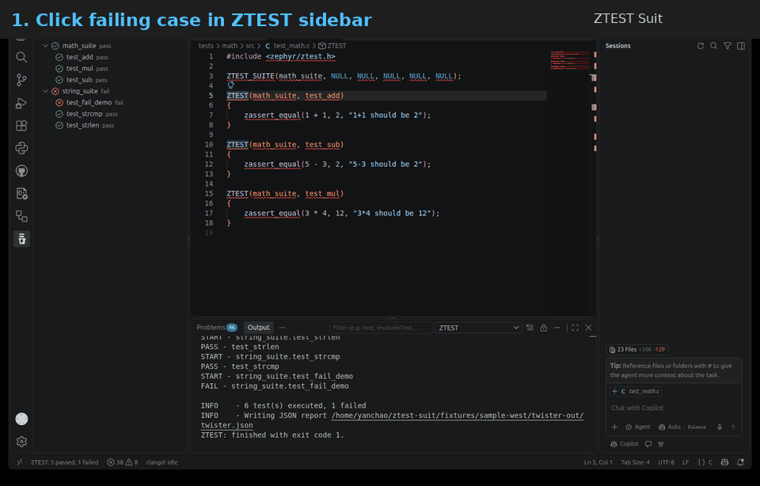
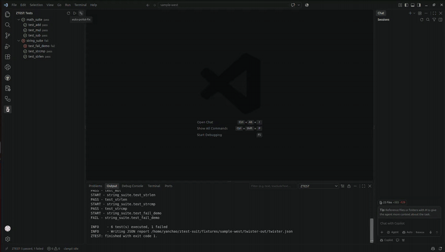
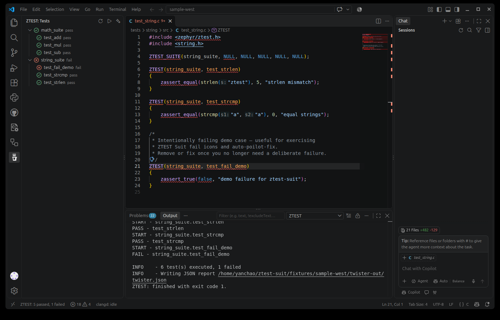

# ZTEST Suit

[](https://github.com/YanChao1999/ztest-suit/actions/workflows/ci.yml)
[](LICENSE)
[](https://code.visualstudio.com/)
[](.cursor/mcp.json)
[](package.json)

VS Code / Cursor extension for Zephyr **ZTEST**: discover suites and cases from source macros, show them in a sidebar, jump to definitions, and run tests through a configurable **west / twister** command wrapper (including Docker entry scripts).



*Click a failing case in the sidebar → jump to the defining `ZTEST(…)` line.*



*Clipped from a real VS Code screencast: **auto-poilot-fix** → Copilot/Agent starts fixing with evidence.*

<details>
<summary>Static screenshot</summary>



</details>

## Features (MVP)

- **Sidebar tree**: suites → cases with pass / fail / not-run / running icons
- **Navigate**: click a case to open the defining source line
- **Manual run**: Run All / Run Suite / Run Case (toolbar + context menu)
- **Command wrapping**: prefix every west invocation (e.g. `./.start_docker.sh -b XXX`)
- **Results**: parse `twister.json` when present; fall back to log heuristics or process exit code
- **auto-poilot-fix**: on failures, open Copilot / Cursor Agent with an **evidence-first** fix prompt

**Not in MVP (planned v2):** auto rebuild/run on save.

## Requirements

- A Zephyr west workspace (or Docker / demo wrapper that can run `west twister`)
- VS Code / Cursor `^1.85.0`

## Quick start

1. Open this folder in VS Code / Cursor
2. `npm install` && `npm run compile`
3. Press **F5** (**Run Extension**) — opens [`fixtures/sample-west`](fixtures/sample-west)
4. **ZTEST** activity bar → **Refresh** → **Run All** → **auto-poilot-fix** after the demo failure
5. Optional real Zephyr: see [`fixtures/sample-west/README.md`](fixtures/sample-west/README.md)

Install the VSIX:

```bash
code --install-extension ./ztest-suit-0.1.0.vsix
```

## Settings

Configure under **Settings → ZTEST Suit** or in `.vscode/settings.json`:

| Setting | Purpose | Example |
|---|---|---|
| `ztest.commandPrefix` | Prepended to west commands | `./.start_docker.sh -b native_sim` |
| `ztest.cwd` | Working directory | `${workspaceFolder}` |
| `ztest.runCommand` | Run template | `{prefix} west twister -T {testPath} --platform {platform} {extraArgs}` |
| `ztest.runSuiteArgs` | Extra args for suite run | `-s {suite}` |
| `ztest.runCaseArgs` | Extra args for case run (MVP runs suite then matches case) | `-s {suite}` |
| `ztest.testPath` | Twister `-T` path | `tests` |
| `ztest.platform` | Platform token | `native_sim` |
| `ztest.reportPath` | JSON report relative to cwd | `twister-out/twister.json` |
| `ztest.scanGlobs` | Source discovery globs | `["**/*.{c,cpp,h,hpp}"]` |
| `ztest.scanExclude` | Paths to skip | `build`, `twister-out*`, `modules`, … |

### Template variables

`{prefix}`, `{workspaceFolder}`, `{testPath}`, `{platform}`, `{suite}`, `{case}`, `{scenario}`, `{extraArgs}`

Empty `commandPrefix` collapses to a bare `west …` command.

### Docker wrapper example

```json
{
  "ztest.commandPrefix": "./.start_docker.sh -b native_sim",
  "ztest.testPath": "tests/bluetooth",
  "ztest.platform": "native_sim",
  "ztest.runCommand": "{prefix} west twister -T {testPath} --platform {platform} {extraArgs}",
  "ztest.runSuiteArgs": "-s {suite}",
  "ztest.reportPath": "twister-out/twister.json"
}
```

## Discovery

- `ZTEST_SUITE(suite, …)`
- `ZTEST(suite, case)` / `ZTEST_F(…)`
- `ZTEST_USER(…)` / `ZTEST_USER_F(…)`

## Commands

| Command | Description |
|---|---|
| `ZTEST: Refresh Tests` | Rescan workspace sources |
| `ZTEST: Run All` | Run configured twister command |
| `ZTEST: Run Suite` | Run with suite filter args |
| `ZTEST: Run Case` | Run suite args, match case in results |
| `ZTEST: Cancel Run` | Kill the running process |
| `ZTEST: Open Case` | Jump to source |
| `auto-poilot-fix` | Failures → Copilot/Agent with evidence-first prompt |

## MCP server

| Tool | Purpose |
|---|---|
| `ztest_list` | Scan macros and list suites/cases |
| `ztest_run` | Run all / suite / case (`dryRun` supported) |
| `ztest_status` | Summary + statuses |
| `ztest_locate` | Suite/case → `file` + `line` |
| `ztest_config` | Effective settings |

```bash
npm run compile
ZTEST_WORKSPACE=./fixtures/sample-west npm run mcp
npm run test:mcp-smoke
```

## Develop

```bash
export PATH="$HOME/.local/node/bin:$PATH"
npm install && npm run compile
npm test
npm run package
```

Homepage screenshots live in [`docs/shots/`](docs/shots/) (captured from a real VS Code session). To refresh after a UI change, open the fixture, Run All, then:

```bash
WID=$(wmctrl -l | grep sample-west | awk '{print $1; exit}')
wmctrl -i -a "$WID"
xwd -id "$WID" -out /tmp/ztest.xwd
ffmpeg -y -i /tmp/ztest.xwd docs/shots/vscode-ztest-run.png
```


## CI / publish

| Workflow | Trigger | What it does |
|---|---|---|
| [CI](.github/workflows/ci.yml) | push / PR | compile + unit + fixture smoke + package VSIX |
| [Publish](.github/workflows/publish.yml) | tag `v*` | re-test, GitHub Release VSIX; Marketplace / Open VSX if secrets set |

```bash
git tag v0.1.0 && git push origin v0.1.0
```

Secrets (optional): `VSCE_PAT`, `OVSX_PAT`.

## License

MIT
